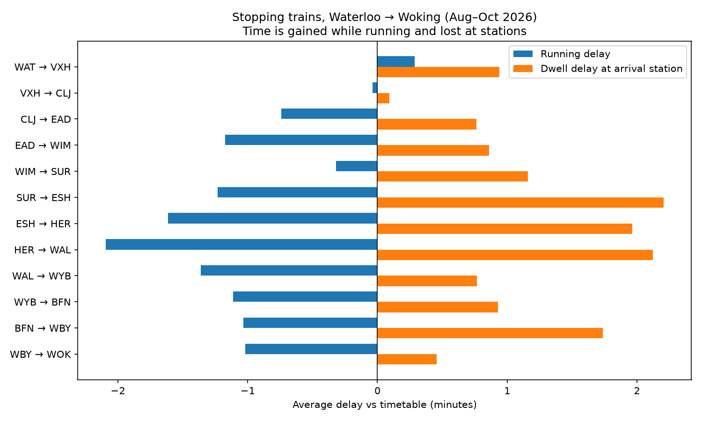
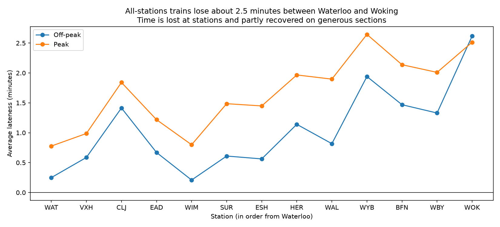

# Timetable Run-Time Risk Simulation: Waterloo → Woking

**How often are scheduled run times on a busy UK main line actually achieved, where do trains fall behind, and what would make the timetable more reliable?**

Using 3 months of real train event data, I measure planned vs actual run and dwell times between every station from London Waterloo to Woking, and build a **Monte Carlo simulation** of journeys to test how timetable changes would affect punctuality.

> **Status: 🚧 In progress.** Data pipeline, cleaning and analysis are complete. The Monte Carlo model is built and being calibrated against real arrivals (see [Simulation](#monte-carlo-simulation-in-progress)). Full working log: [docs/PROGRESS.md](docs/PROGRESS.md)

---

## Key findings so far

**1. Fewer than half of trains reach Woking on time** (less than 1 minute late, Aug–Oct 2026)

| | Off-peak | Peak |
|---|---|---|
| All trains | 40.6% | 34.2% |
| All-stations trains only | 34.9% | 41.6% |

**2. Trains gain time while running, but lose it at stations**



On almost every section, stopping trains run *faster* than the timetable, yet stand *longer* than planned at stations. Much of that extra standing time is trains that arrived early **waiting for their departure time**. The real time pressure is on the inner London sections (Waterloo → Clapham Junction), where trains have no time to spare.

**3. Lateness builds in a sawtooth**



Following the same 2,124 all-stations trains down the line, lateness rises at stations and is partly recovered on sections with generous running time, growing overall from about 0.25 to about 2.6 minutes.

**4. Watch out for composition effects**

Averaging *all* trains at each station produced a misleading zigzag, because each station is served by a different mix of trains (stopping, semi-fast, fast). Comparing **the same trains** at every station removed part of the pattern.

---

## Data

| Dataset | Source | Used for |
|---|---|---|
| **Historical Service Performance (HSP)** | National Rail Data Portal (free API, registration required) | Scheduled and actual times at every station for every train |

- **Period:** 1 Aug – 31 Oct 2026, weekdays. This stays within one timetable period, since UK timetables change in May and December.
- **Volume:** 13,678 train runs → 182,296 station calls → 159,647 clean sections.
- Raw data is not stored in this repository.

### Data quality

| Step | Sections | % |
|---|---|---|
| Before cleaning | 168,618 | 100% |
| Recording gaps (missing actual times) | −6,265 | 3.7% |
| Impossible negative run times | −3 | <0.01% |
| Bank holiday (31 Aug, different timetable) | −2,703 | 1.6% |
| **Kept** | **159,647** | **94.7%** |

---

## Method

```
HSP API ──► fetch.py ──► prepare.py ──► notebooks/ ──► simulate.py
(raw JSON)   (train runs,   (section run &   (exploration    (Monte Carlo
             station calls)  dwell times)     & charts)       journeys)
```

**Extraction (`fetch.py`)**
- `serviceMetrics` finds every train run between the two stations; `serviceDetails` gets station-by-station times for each run.
- The API timed out on large requests. A controlled test showed **wide time windows** were the cause (not long date ranges), so requests are split into **monthly × 2-hour windows**.
- Retries with backoff, polite rate limiting, and **per-train caching**, so a 2-hour download can resume where it stopped.

**Preparation (`prepare.py`)**
- Times converted to minutes since midnight, with handling for trains **crossing midnight** in both directions.
- **"Best available time"** rule for pick-up-only and set-down-only stops, where a station has an arrival or a departure but not both.
- Section **run time** (moving) and station **dwell time** (standing) calculated separately, after reconciling one train by hand showed that its delay came from dwells, not running.
- Each cleaning step is logged as an audit trail; trains are labelled peak (07:00–09:59, 16:00–18:59 departures) or off-peak.

**Exploration (`notebooks/01_explore.ipynb`)**
- Delay by section, lateness profiles, on-time rates, and the composition effect check.

---

## Monte Carlo simulation (in progress)

Each simulated journey starts with a real Waterloo departure lateness, then for every section samples a **real running delay** and a **real dwell overrun** from the data, applying a "can't depart early" rule. 10,000 journeys give a distribution of arrival lateness at Woking.

**Validation against real arrivals (all-stations trains):**

| | Simulated v1 | Real |
|---|---|---|
| Off-peak on time | 20.2% | 34.9% |
| Peak on time | 31.9% | 41.6% |

Version 1 is **too pessimistic**. Diagnosis so far:
- A first theory (rounded departure times) gave a convincing back-of-envelope match, but fixing it **did not close the gap**, so it was ruled out.
- Testing whether delays depend on lateness showed that **late trains catch up while running** (−1.2 min per section, against −0.2 for early trains). Independent sampling gives every train the average, so simulated late trains stay too late.
- **Next:** conditional sampling, drawing running delays from real trains that left with similar lateness, so the model learns catch-up behaviour from the data.

Once validated, the model will be used to test **run-time changes**, e.g. *"how much does adding 1 minute to a section improve on-time arrivals?"*

---

## Limitations

- **Public timetable times are rounded to whole minutes**, so short stops appear as 0-minute stops, which inflates apparent dwell delays.
- **Cancellations are largely invisible:** HSP only includes trains with a recorded arrival, so this measures lateness, not cancellations.
- **Trains are modelled independently.** The simulation does not capture trains blocking each other, which full timetable simulators do.
- Results cover one route over one timetable period.

---

## Project structure

```
src/runtime_sim/
    config.py      settings: route, dates, peak windows, paths
    fetch.py       HSP API extraction with chunking, retries and caching
    prepare.py     section run and dwell times, cleaning, peak labels
    simulate.py    Monte Carlo simulation and validation
notebooks/
    01_explore.ipynb   exploration and charts
outputs/figures/   charts used in this README
docs/PROGRESS.md   detailed project log: decisions, bugs and lessons
```

## How to run

```bash
python3 -m venv .venv
source .venv/bin/activate
pip install -r requirements.txt
pip install -e .
cp .env.example .env          # add your National Rail Data Portal login (HSP)

python src/runtime_sim/fetch.py      # ~2 hours for 3 months (resumable)
python src/runtime_sim/prepare.py    # builds data/processed/sections.csv
python src/runtime_sim/simulate.py   # runs the simulation and validation
```

Settings such as the route and dates are in `src/runtime_sim/config.py`.

---

## Tools
Python · pandas · NumPy · Matplotlib · Jupyter · REST API (requests) · Git

**Author:** Samuel Ayisi Yeboah · [GitHub](https://github.com/SAMUELAY1)
